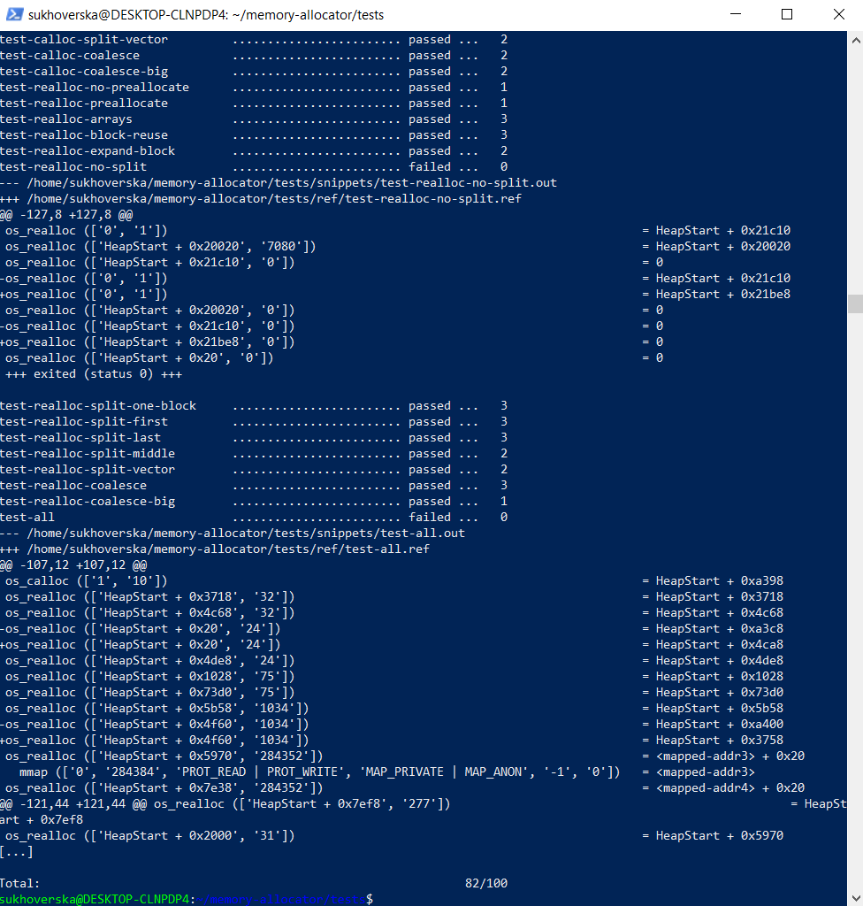

# Memory Allocator

Мінімальний алокатор пам'яті на C: `os_malloc`, `os_calloc`, `os_realloc`, `os_free`
(на основі `brk()`/`sbrk()`, `mmap()` і `munmap()`).

Умова завдання: [open-education-hub/operating-systems — memory-allocator](https://github.com/open-education-hub/operating-systems/tree/main/content/assignments/memory-allocator) (копія в `TASK.md`).

## Реалізація (`src/osmem.c`)
- вирівнювання до 8 байт, заголовок `struct block_meta` (32 байти) перед кожним блоком;
- блоки < 128 KB (`MMAP_THRESHOLD`) — у купі через `sbrk`, більші — через `mmap`; для `os_calloc` поріг — розмір сторінки;
- попереднє виділення 128 KB купи при першому використанні;
- find best, розщеплення блоків, злиття сусідніх вільних блоків;
- розширення останнього вільного блоку замість створення нового;
- `os_realloc` спершу пробує змінити блок на місці (обрізання, розширення останнього блоку, злиття з наступними вільними), інакше переносить дані.

## Збірка і тести
```bash
cd tests
make check
```

## Результат запуску тестів

